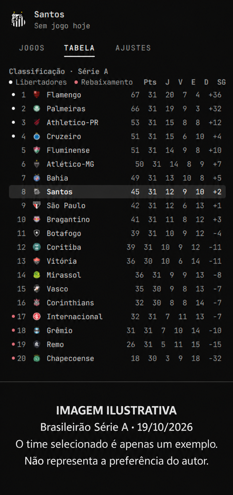

# Tabela Brasileirão Série A para Omarchy

[English (US)](README.en-US.md) · Português (Brasil)

Placar ao vivo, jogos do dia e classificação do Brasileirão na barra do Omarchy.
Escolha seu time para receber notificações e comemorações opcionais.
Nome em inglês: **Brazilian Série A Standings for Omarchy**.



**Imagem ilustrativa:** captura da tabela do Brasileirão Série A exibida pelo
plugin em **19/10/2026**. A classificação pode mudar após essa data. O time
selecionado e os destaques servem apenas para demonstrar a interface e **não
representam as preferências futebolísticas do autor do plugin**.

## Requisitos e instalação

Omarchy 4.0+ com plugins da shell, Quickshell/QtQuick, `curl` 8.4+,
`python3` 3.8+ e `notify-send` (pacote `libnotify`). Internet necessária;
não exige conta, chave de API ou token.

```sh
omarchy plugin add https://github.com/JohnRenatoDev/omarchy-tabela-brasileirao-serie-a.git --enable
```

O repositório foi renomeado de `omarchy-football` para
`omarchy-tabela-brasileirao-serie-a`. O ID permanente continua
`russio.football`, preservando configurações existentes.
O instalador pede consentimento para adicionar/habilitar o plugin. Não há
instalador que exija elevação de privilégios nem alteração automática de outros plugins.
Se necessário, execute `omarchy restart shell`.

## Uso

Clique na bola ou no placar para abrir o painel; `Q` ou `Esc` fecha o painel.
As setas esquerda/direita alternam as abas quando a busca não está em edição.

| Aba | Conteúdo |
| --- | --- |
| Jogos | Partida do seu time e jogos do dia. Outra partida seleciona o mandante; clicar na partida já seguida mantém seu time. |
| Tabela | Pontos, jogos, vitórias, empates, derrotas e saldo. Clique em um clube para segui-lo. |
| Ajustes | Busca de times, parar de seguir, notificações, comemorações, alerta rival e prévias. |

A barra mostra o horário local antes do jogo, placar/minuto durante a partida,
`INT` no intervalo e `FIM` no término. O resultado permanece por cerca de 30
minutos após a primeira detecção do fim. Depois aparece a bola, ou o espaço
é oculto se `badgeWhenIdle` for falso. A bola também aparece sem time selecionado.

Comemorações duram aproximadamente 2,6 segundos; o aviso rival, 1,9 segundo.
As superfícies não solicitam foco de teclado e têm região de entrada vazia.
Notificações, comemoração e alerta rival são independentes. Prévias são ações
explícitas e funcionam mesmo com o respectivo efeito automático desligado.

## Configuração

Use os controles do painel. Os ajustes pertencem à entrada `russio.football`
em `~/.config/omarchy/shell.json`. Exemplo de entrada, não de arquivo completo:

```json
{
  "id": "russio.football",
  "league": "bra.1",
  "team": "2674",
  "teamName": "Santos",
  "goalNotifications": true,
  "goalCelebration": true,
  "rivalAlert": true,
  "badgeWhenIdle": true
}
```

| Chave | Padrão | Efeito |
| --- | --- | --- |
| `league` | `bra.1` | Liga ESPN; aceita códigos como `bra.2`, `bra.3`, `eng.1`. Inválidos usam `bra.1`. |
| `team` / `teamName` | vazio | ID decimal positivo de até dez dígitos e nome do time seguido. |
| `goalNotifications` | `true` | Notificações de gols, início e fim. |
| `goalCelebration` | `true` | Comemoração automática dos gols do seu time. |
| `rivalAlert` | `true` | Efeito automático quando o adversário marca. |
| `badgeWhenIdle` | `true` | Mantém a bola acessível sem partida. |

A interface está em PT-BR. Na Série A (`bra.1`), as faixas indicativas são:
- **1º–4º:** Libertadores (azul).
- **5º:** Pré-Libertadores (azul-claro).
- **6º–11º:** Sul-Americana (rosa).
- **17º–20º:** Rebaixamento (cor de alerta do tema), em uma tabela de 20 clubes.

São referências fixas, não uma confirmação de classificação: vagas extras,
campeões de copas e mudanças de regulamento podem alterar os classificados.
As faixas continentais não são aplicadas a outras ligas; nas tabelas com mais de
12 clubes, os quatro últimos continuam marcados como rebaixamento indicativo.

## Dados, rede e privacidade

| Uso | Destino HTTPS |
| --- | --- |
| Jogos | `site.api.espn.com/apis/site/v2/sports/soccer/<league>/scoreboard` |
| Classificação | `site.api.espn.com/apis/v2/sports/soccer/<league>/standings` |
| Escudos | `a.espncdn.com/i/teamlogos/soccer/500/<id>.png` |

URLs de escudos recebidas no JSON são ignoradas: o destino deriva de um ID
validado. Downloads aceitam somente HTTPS, não seguem redirecionamentos e
ignoram `.curlrc`. Não há telemetria ou envio de credenciais. ESPN/CDN recebem
requisições normais, incluindo seu endereço de rede; proxy/DNS/TLS locais são
responsabilidade do sistema. A API externa pode mudar, atrasar ou limitar pedidos.

Placar: 25 segundos com jogo ao vivo do time seguido, 90 segundos com partida
agendada/recém-encerrada, dez minutos sem jogo. Classificação: 30 minutos, ou ao
abrir o painel se antiga. JSON: até 2 MiB e 100 partidas/linhas processadas.
Falhas de rede ou JSON inválido preservam os últimos dados válidos com aviso.

Escudos: downloads sequenciais, até 200 IDs distintos por instância/sessão,
armazenados em `~/.cache/omarchy/football/<id>.png` com temporários privados e
substituição atômica. Limite de 2 MiB, assinatura PNG e dimensões até 2048 × 2048
verificadas; isso não substitui a segurança do decodificador do Qt. Quando a URL
canônica não existe ou o download falha, aparece a abreviação; sem nova tentativa
na mesma sessão. Cache persiste entre sessões, sem limpeza automática.
Em vários monitores pode haver pedidos/alertas por instância, sem sincronização.

## IPC

```sh
omarchy-shell russio.football toggle
omarchy-shell russio.football open
omarchy-shell russio.football close
omarchy-shell russio.football refresh
omarchy-shell russio.football status
omarchy-shell russio.football openTab tabela
omarchy-shell russio.football celebrate
omarchy-shell russio.football rivalGoal
```

`openTab` aceita `jogos`, `tabela` e `ajustes`. `status` informa versão, contagens
e erros da última atualização. As prévias `celebrate` e `rivalGoal` exigem time
selecionado. Omarchy/Quickshell gerencia o acesso ao IPC.

## Atualização e remoção

```sh
omarchy plugin update russio.football
omarchy plugin remove russio.football
```

O gerenciador descarrega/remove o plugin. Para apagar também os escudos,
execute separadamente, se desejar:

```sh
rm -rf -- "$HOME/.cache/omarchy/football"
```

## Desenvolvimento e licença

`Panel.qml`: interface/IPC; `Model.js`: interpretação dos dados;
`CrestCache.py`: download e gravação. Valide com `omarchy plugin validate .`
e `git diff --check`.

### Direitos sobre código, preview e conteúdo de terceiros

O código é distribuído sob a [licença MIT](LICENSE). O mantenedor confirma ter
os direitos ou as permissões necessários para publicar o código e o preview
incluídos neste repositório e submetê-los ao marketplace.

Escudos, nomes e marcas dos clubes, assim como dados e conteúdo da ESPN,
pertencem aos respectivos titulares. A licença MIT do código não se aplica
automaticamente a esses elementos e não concede autorização para sua
redistribuição ou uso de marcas. Sua exibição no plugin ou no preview não
transfere direitos nem implica endosso. O uso desses elementos deve respeitar
as permissões e condições aplicáveis dos respectivos titulares.

Este é um projeto independente, sem afiliação, patrocínio ou endosso da ESPN,
dos clubes ou dos organizadores da competição. Para comunicar um problema
relacionado a direitos ou solicitar revisão de um asset, abra uma
[issue no repositório](https://github.com/JohnRenatoDev/omarchy-tabela-brasileirao-serie-a/issues).
